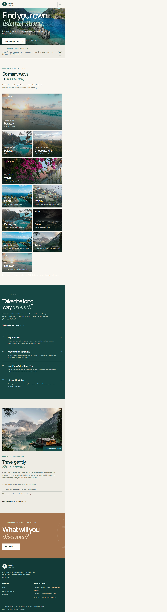

# Lakbay Pilipinas 🇵🇭
### Discover the Beauty of the Philippines

**A Multi-Page Laravel Tourism Website**

## Project Information

| Detail | Information |
|---|---|
| Project Name | Lakbay Pilipinas |
| Project Type | Multi-Page Laravel Web Application |
| Theme | Philippine Tourism |
| Framework | Laravel 13 |
| Language | PHP, HTML, CSS, JavaScript |
| Repository | Lara-Proj-EULM1-Egay-Valdehueza-Monter |
| Section | [Your Section] |
| Group Members | [Insert Group Members' Names] |

---

## About the Project

Lakbay Pilipinas is a tourism information website created to showcase the beauty, destinations, and attractions of the Philippines. It aims to give visitors a simple and enjoyable way to discover different places across the country through an organized and visually engaging website.

The Philippines is known for its beautiful beaches, mountains, historical landmarks, natural attractions, and vibrant cities. This project brings some of these destinations together in one platform, allowing visitors to explore selected locations and learn more about the purpose of the website.

Built with Laravel, Lakbay Pilipinas demonstrates how multiple website pages can work together within a single web application. Each page has its own content, styling, and JavaScript functionality while sharing a common layout and navigation system.

## Project Objectives

- Develop a functional multi-page website using the Laravel framework.
- Present Philippine tourism destinations through an organized and attractive interface.
- Apply HTML, CSS, and JavaScript within Laravel Blade templates.
- Implement a shared layout that maintains consistent navigation and page structure.
- Add interactive JavaScript features to improve the browsing experience.
- Practice collaborative development using Git, GitHub branches, commits, and Pull Requests.

## Website Pages and Features

### 🏝️ Home

The Home page serves as the main landing page of Lakbay Pilipinas. It introduces visitors to the website through tourism-related visuals and highlights selected destinations across the Philippines.

**Features:**
- Shared navigation linking to the website's main pages.
- Tourism-themed hero section.
- Introduction to the Lakbay Pilipinas website.
- Featured Philippine destinations.
- Destination cards with images.
- Interactive image slider or carousel.
- Organized and responsive content sections.

### 🌏 About

The About page introduces the background and purpose of Lakbay Pilipinas. It provides visitors with a better understanding of the website and the people behind the project.

**Features:**
- Website background and introduction.
- Information about the project's purpose.
- Team or member information.
- Read More and Read Less interaction.
- Consistent navigation and shared layout.

### ✉️ Contact

The Contact page provides a form interface where visitors can enter their information and compose a message.

**Features:**
- Name, email, subject, and message fields.
- Client-side form validation.
- Error messages for empty or invalid fields.
- Success message when the form is valid.
- Organized and responsive form layout.

**Current limitation:** The Contact form demonstrates frontend validation and feedback. It does not currently save submissions to a database or send emails.

---

## Technologies and Tools

| Technology / Tool | Purpose |
|---|---|
| PHP 8.3+ | Server-side programming language |
| Laravel 13 | Main web application framework |
| Blade | Template engine for Laravel views |
| HTML5 | Structure and content of website pages |
| CSS3 | Styling, layouts, and responsive design |
| JavaScript | Interactive features and client-side validation |
| Composer | PHP dependency management |
| Git | Version control |
| GitHub | Repository hosting and collaboration |
| Visual Studio Code | Code editing and development |

## Application Structure

The project follows Laravel's standard directory structure. Each page has its own Blade template, CSS file, and JavaScript file, while shared components are maintained separately.

```text
Lara-Proj-EULM1-Egay-Valdehueza-Monter/
│
├── app/
├── bootstrap/
│
├── config/
│   └── tourism.php
│
├── database/
│
├── public/
│   ├── css/
│   │   ├── app.css
│   │   ├── home.css
│   │   ├── about.css
│   │   └── contact.css
│   │
│   ├── js/
│   │   ├── app.js
│   │   ├── home.js
│   │   ├── about.js
│   │   └── contact.js
│   │
│   └── images/
│
├── resources/
│   └── views/
│       ├── layouts/
│       │   └── app.blade.php
│       ├── home.blade.php
│       ├── about.blade.php
│       └── contact.blade.php
│
├── routes/
│   └── web.php
│
├── storage/
├── tests/
│
├── .env.example
├── artisan
├── composer.json
├── composer.lock
└── README.md
```

### How the Application Is Organized

- **`resources/views/layouts/app.blade.php`** – Contains the shared layout, navigation, footer, and content sections used by the website.
- **`resources/views/`** – Contains the individual Blade templates for the Home, About, and Contact pages.
- **`public/css/`** – Stores the shared stylesheet and individual page stylesheets.
- **`public/js/`** – Stores shared JavaScript and page-specific scripts.
- **`public/images/`** – Contains the local images used throughout the website.
- **`routes/web.php`** – Defines the URLs that connect visitors to the corresponding pages.
- **`config/tourism.php`** – Stores tourism-related configuration and website content.
- **`app/`** – Contains the main Laravel application code.
- **`storage/`** – Holds application-generated files and framework data.

## Laravel Routing

The application uses Laravel routes to connect each URL to its corresponding Blade view.

| Page | URL | Route Name |
|---|---|---|
| Home | `/` | `home` |
| About | `/about` | `about` |
| Contact | `/contact` | `contact` |

All three pages use the shared layout and provide navigation links so visitors can move between sections of the website.

## Shared Layout and Blade Templates

The website uses Laravel Blade to organize its pages and avoid repeating common HTML structures.

The shared layout provides:
- A common navigation bar.
- A footer containing the group information.
- A content section through `@yield('content')`.
- A styles stack through `@stack('styles')`.
- A scripts stack through `@stack('scripts')`.

Individual pages extend the shared layout using:

```php
@extends('layouts.app')

@section('content')
    <!-- Page content -->
@endsection
```

Page-specific CSS and JavaScript are loaded through Blade stacks using Laravel's `asset()` helper.

Example:

```php
@push('styles')
    <link rel="stylesheet" href="{{ asset('css/home.css') }}">
@endpush

@push('scripts')
    <script src="{{ asset('js/home.js') }}"></script>
@endpush
```

This structure keeps the application organized and allows each page to maintain its own styling and functionality.

---

## Installation and Setup

Follow these instructions to download and run the application on your local computer.

### Prerequisites

Make sure the following tools are installed:

- PHP 8.3 or later
- Composer
- Git
- A modern web browser
- A compatible Laravel 13 environment

### 1. Clone the repository

```bash
git clone YOUR_GITHUB_REPOSITORY_URL
```

Replace the placeholder with the actual repository URL.

### 2. Open the project directory

```bash
cd Lara-Proj-EULM1-Egay-Valdehueza-Monter
```

### 3. Install dependencies

```bash
composer install
```

### 4. Create the environment file

For Windows PowerShell:

```powershell
Copy-Item .env.example .env
```

### 5. Generate the application key

```bash
php artisan key:generate
```

### 6. Configure local session and cache storage

Open the `.env` file and make sure these settings are present:

```env
SESSION_DRIVER=file
CACHE_STORE=file
```

The current website pages do not require database-backed sessions or cache storage.

### 7. Clear the configuration cache

```bash
php artisan config:clear
```

### 8. Start the development server

```bash
php artisan serve
```

### 9. Open the application

Visit the following address:

```text
http://127.0.0.1:8000
```

You can now navigate through the Home, About, and Contact pages.

**Database note:** The current website functionality does not require database operations. Database setup and migrations are therefore not necessary just to run the three pages.

---

## Screenshots

The following screenshots can be used to show the appearance and functionality of the completed application.

### Home Page



### About Page


### Contact Page


*Replace the example image paths above with the actual screenshot filenames in the repository.*

---

## GitHub Collaboration Workflow

The project uses Git and GitHub to organize development and combine the different pages into one application.

The group follows a branch-based workflow:

1. Each developer works on their assigned branch.
2. Changes are committed with meaningful commit messages.
3. Completed branches are pushed to the GitHub repository.
4. A Pull Request is created to propose merging changes into `main`.
5. The Group Leader reviews and merges the Pull Requests.
6. The integrated application is checked to make sure all pages and navigation work correctly.

The `main` branch represents the integrated version of the application.

**Important:** The `.env` file and `vendor/` directory should not be committed to GitHub. Laravel's `.gitignore` excludes these files and folders by default.

---

## Project Scope and Limitations

Lakbay Pilipinas is currently focused on tourism information and frontend website functionality.

The current version includes:
- Three integrated website pages.
- Shared Blade layout and navigation.
- Local CSS, JavaScript, and image assets.
- Interactive frontend features.
- Client-side contact form validation.

The current version does not include:
- User registration or authentication.
- Database-backed tourism content.
- Database storage for contact submissions.
- Actual email delivery.
- Online reservations or booking services.
- Online payments.

These features are outside the current implementation.

## Acknowledgments and Image Credits

The project uses local tourism-related photographs and visual resources to represent Philippine destinations.

Original image sources, creators, and license information should be retained and acknowledged in accordance with their respective licenses.

This application was developed as an academic group project for the Laravel multi-page web application activity.

It is an independent educational project and is not an official website of the Philippine Department of Tourism or any government agency.

---

## Lakbay Pilipinas 🇵🇭

**Discover. Explore. Experience the Philippines.**
